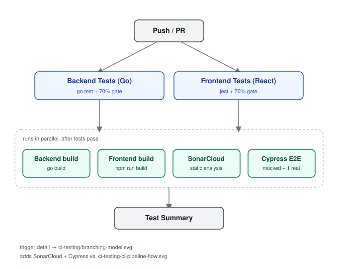

# Forum App — QA Pipeline

[](https://github.com/CarpinetiOctavio/forum-app-qa-pipeline/actions/workflows/ci.yml)

This repository adds three quality gates to the unit-test pipeline of the first one: a 70% coverage threshold, SonarCloud static analysis and Cypress end-to-end tests. Every push to `feature/**`, `staging` or `main`, and every pull request into `staging` or `main`, runs seven jobs: 50 backend tests at 88.2% coverage of the Services layer, 51 frontend tests, and 21 Cypress tests, 19 against mocked responses and 2 against the real backend and database ([run `43384887706`](https://github.com/CarpinetiOctavio/forum-app-qa-pipeline/actions/runs/43384887706)). A ruleset requires all seven checks before a merge into `staging` or `main`; on a pull request into `main`, a failing SonarCloud quality gate fails its job and blocks the merge ([PR #59](https://github.com/CarpinetiOctavio/forum-app-qa-pipeline/pull/59), [screenshot](docs/screenshots/09-quality-gate-blocks-pr-into-main.png)).

> **Series.** This is the second of three repositories: [ci-testing](https://github.com/CarpinetiOctavio/forum-app-ci-testing) → **qa-pipeline** → [cloud-deploy](https://github.com/CarpinetiOctavio/forum-app-cloud-deploy). The split follows the course's assignments (TP6, TP7, TP8 of Software Engineering III, UCC); in practice it would be one repository with tags.

Reading paths: in 30 seconds, the opening paragraph; in five minutes, "What this repository shows", "Limitations" and "Errors I found and corrected"; in depth, the decision record each point and each error links. The rest is reference.

## Status

Closed. This repository started in 2026 as a copy of `forum-app-ci-testing@v1.1.0`, not as a continuation of the original TP7 submission (October 2025), which is preserved, archived, at [`forum-app-qa-pipeline-legacy`](https://github.com/CarpinetiOctavio/forum-app-qa-pipeline-legacy) ([ADR-000](docs/decisions/ADR-000-starting-from-ci-testing-v1.1.0.md)). Decisions are recorded in [`docs/decisions/`](docs/decisions/). `CLAUDE.md` and [`docs/rules/`](docs/rules/) are operating instructions for an AI assistant working in this repository, not project documentation.

## What this repository shows

1. **A 70% coverage gate, measured only where the business rules live.** The backend gate covers `internal/services/`, and the frontend gate covers components and services. 100% would reward tests written for the number; measuring wiring and type definitions would make the percentage say nothing ([ADR-001](docs/decisions/ADR-001-coverage-strategy.md)).
2. **SonarCloud's quality gate blocks the path to `main`.** The scanner waits for the gate, and a red gate fails the job, on pull requests into `main` and on pushes to `main`: the gate is required only there. On the Free plan, waiting on a push to `feature/**` fails the job ([run `43382798700`](https://github.com/CarpinetiOctavio/forum-app-qa-pipeline/actions/runs/43382798700); [ADR-002](docs/decisions/ADR-002-sonarcloud.md)).
3. **Cypress against mocked responses, except where a mock would hide the rule.** `DeleteComment` checks authorship in a SQL `WHERE` clause, which a mocked test can't reach; its two tests run against the real backend and SQLite. The other 19 use `cy.intercept()` ([ADR-003](docs/decisions/ADR-003-cypress.md)).
4. **The slow gates run after the fast ones.** SonarCloud and Cypress wait for the unit-test jobs, in parallel with each other: a failing unit test stops the run before static analysis and E2E spend time on it ([ADR-004](docs/decisions/ADR-004-pipeline-extension.md)).

## Limitations

- **The SonarCloud gate is required only on the path to `main`.** Pull requests into `staging` have a gate, measured against `main` on the Free plan, but are not blocked, and `feature/**` branches are analyzed without a gate. A SonarCloud outage blocks merges into `main` ([ADR-002](docs/decisions/ADR-002-sonarcloud.md)).
- **Mocked E2E tests prove the UI given a response, not that the backend produces it**; only `DeleteComment` runs end to end ([ADR-003](docs/decisions/ADR-003-cypress.md)).
- **No real authentication.** Authorization tests verify the authorship comparison, not the caller's identity: the app trusts a client-supplied `X-User-ID` header, inherited from [ci-testing's ADR-008](https://github.com/CarpinetiOctavio/forum-app-ci-testing/blob/main/docs/decisions/ADR-008-app-security-scope.md).
- **`cypress/support/**` is excluded from coverage**: no tool in this pipeline instruments it ([ADR-001](docs/decisions/ADR-001-coverage-strategy.md)).
- **The Cypress job installs with `npm install`, not `npm ci`**, an accepted SonarCloud finding ([ADR-003](docs/decisions/ADR-003-cypress.md)).
- **Containers, a registry and deployment** are [cloud-deploy](https://github.com/CarpinetiOctavio/forum-app-cloud-deploy)'s scope.

## Errors I found and corrected

- I configured `sonar.sources` and `sonar.tests` so that SonarCloud analyzed almost nothing for over a day; it took four rounds to get them right ([ADR-002](docs/decisions/ADR-002-sonarcloud.md)).
- My trigger never ran the pipeline on merges into `staging` or `main` ([ADR-004](docs/decisions/ADR-004-pipeline-extension.md)).
- I left the SonarCloud job green with the quality gate red: nothing waited for the gate ([ADR-002](docs/decisions/ADR-002-sonarcloud.md)).
- I relied on the Cypress action's own wait for the frontend; it ended within milliseconds instead of waiting, and I replaced it with `wait-on` ([ADR-003](docs/decisions/ADR-003-cypress.md)).
- I used `wait-on`'s `http://` scheme, which sends `HEAD` to a route that only accepts `GET` ([ADR-003](docs/decisions/ADR-003-cypress.md)).
- I presented as a gap a ruleset that was already covered by `Test Summary` ([ADR-004](docs/decisions/ADR-004-pipeline-extension.md)).
- I wrote in ADR-000 that `ci-testing` already ran on Node.js 24; it did not ([ADR-000](docs/decisions/ADR-000-starting-from-ci-testing-v1.1.0.md)).

## Decisions

Every decision, with its alternatives and later amendments, is in [`docs/decisions/`](docs/decisions/).

## Evidence



The figures above come from [run `43384887706`](https://github.com/CarpinetiOctavio/forum-app-qa-pipeline/actions/runs/43384887706). GitHub keeps Actions logs for 90 days; [`docs/screenshots/`](docs/screenshots/) is the record after that.

## Running it

Requires Go 1.24+ and Node.js 24. The test commands CI runs:

```bash
cd backend && go test ./tests/services/... -v -coverprofile=coverage.out -coverpkg=./internal/services/...
cd frontend && npm test -- --coverage --watchAll=false
```

Setup, including what the pipeline needs from SonarCloud, is in [`docs/SETUP.md`](docs/SETUP.md); the remaining commands, Cypress included, are in [`docs/COMMANDS.md`](docs/COMMANDS.md).

## AI disclosure

Language models (Claude, in chat sessions and through Claude Code) were used to audit the repository, check claims against it, and write text and code. Every design choice was decided by Octavio Carpineti. Only some commits carry a `Co-Authored-By` trailer for that use; the record is irregular.

## License

MIT ([LICENSE](LICENSE)).
