# Screenshots

GitHub keeps Actions logs for 90 days; these captures are the record after that. Each one states what it shows and which decision it supports. Captures 04 and 05 come from run `30719745430` (August 2026), before the amendments of 2026-11-12; the figures in the README come from a later run. Captures 06a–07 show the application running locally.

## Branch protection

**00 — The ruleset's required checks.** The ruleset on `staging` and `main` requires all seven jobs: `Test Summary` and the six it aggregates ([ADR-004](../decisions/ADR-004-pipeline-extension.md)).

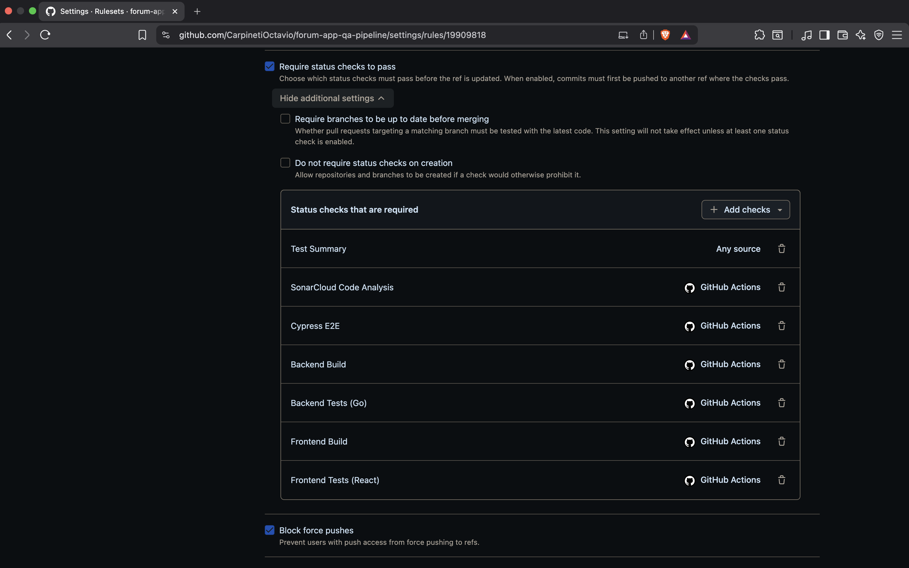

**01 — Gate on a pull request into `main`.** Pull request #38: merging stays blocked while the seven required checks have not reported.

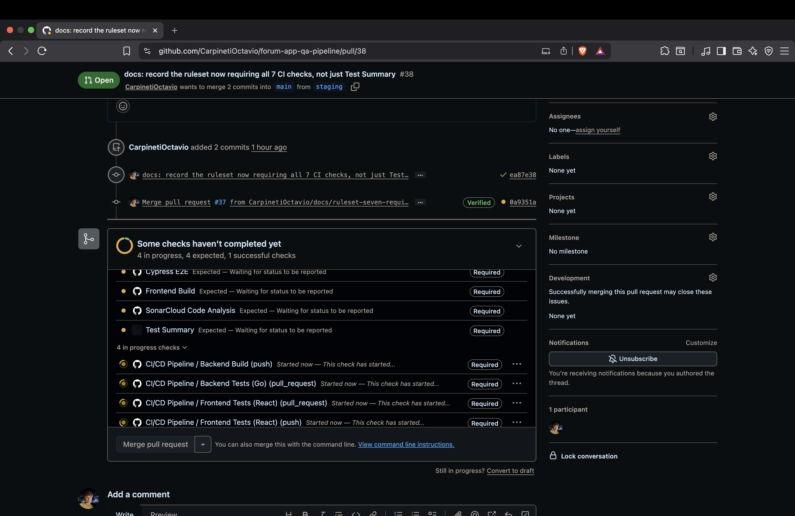

## SonarCloud

**02 — A finding marked as a false positive.** `githubactions:S6505` on an `npm install` step in `ci.yml` (pull request #29), closed with its reason: `allowScripts` in `package.json` already blocks other packages' install scripts, which the rule's text check cannot see ([ADR-003](../decisions/ADR-003-cypress.md)).

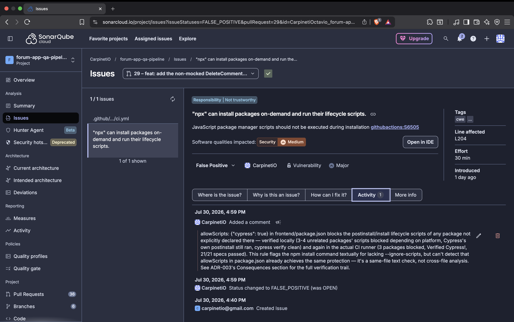

**03 — Quality gate passed on `main`.** The default gate, "Sonar way": 92.25% coverage on new code, against the required 80% ([ADR-002](../decisions/ADR-002-sonarcloud.md)).

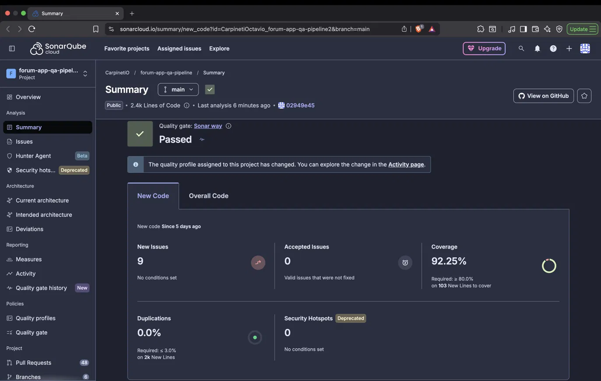

**08 — Free plan: no data outside `main`.** Opening the analysis of a `feature/**` branch returns "Organization is not allowed to access data from non main branches" ([ADR-002](../decisions/ADR-002-sonarcloud.md#amendment-2026-11-12-the-quality-gate-now-blocks-on-the-path-to-main-within-the-free-plans-limits), amendment).

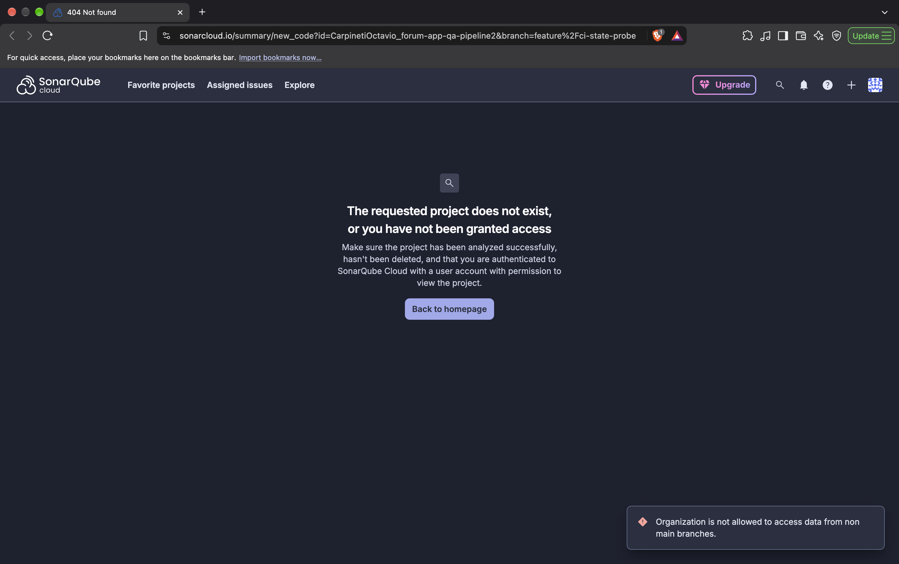

**09 — A red quality gate blocks a pull request into `main`.** Pull request #59, a disposable probe closed without merging: the gate fails on 0.0% coverage on new code, `SonarCloud Code Analysis` and `Test Summary` fail, and the merge is blocked ([ADR-002](../decisions/ADR-002-sonarcloud.md#amendment-2026-11-12-the-quality-gate-now-blocks-on-the-path-to-main-within-the-free-plans-limits), amendment).

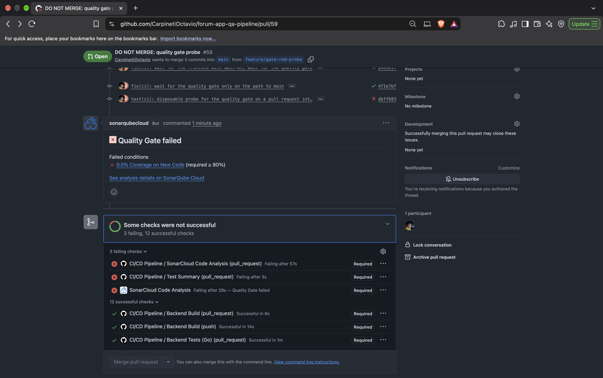

## Pipeline

**04 — Pipeline run on a push to `main`.** The seven jobs pass; SonarCloud and Cypress start after both test jobs, and the 21 Cypress tests pass ([ADR-004](../decisions/ADR-004-pipeline-extension.md)).

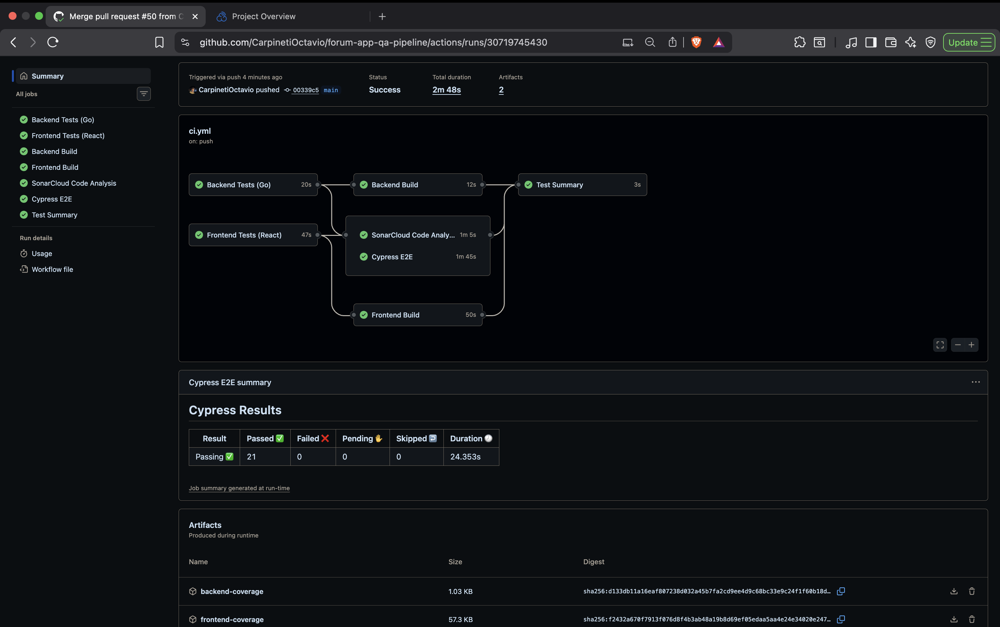

**05 — The real `DeleteComment` tests.** Both tests in `delete-comment-real.cy.ts` pass against the real backend and SQLite: a non-author's deletion is rejected, even through a direct API call, and the author's succeeds ([ADR-003](../decisions/ADR-003-cypress.md)).

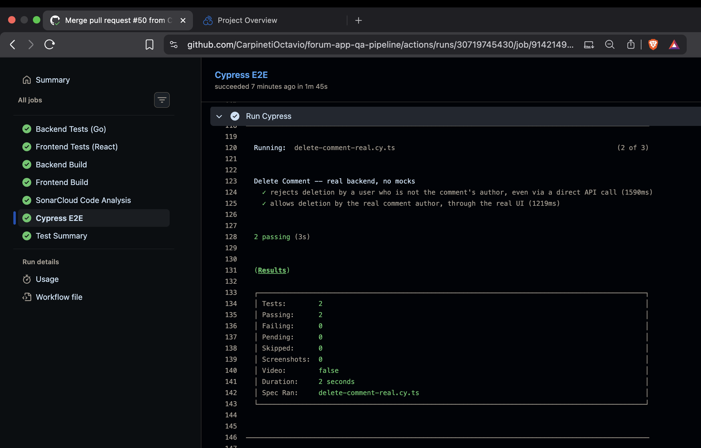

## Edit

**06a — Edit button for the author.** Logged in as the post's author, the post shows an Edit button ([ADR-005](../decisions/ADR-005-edit-functionality.md)).

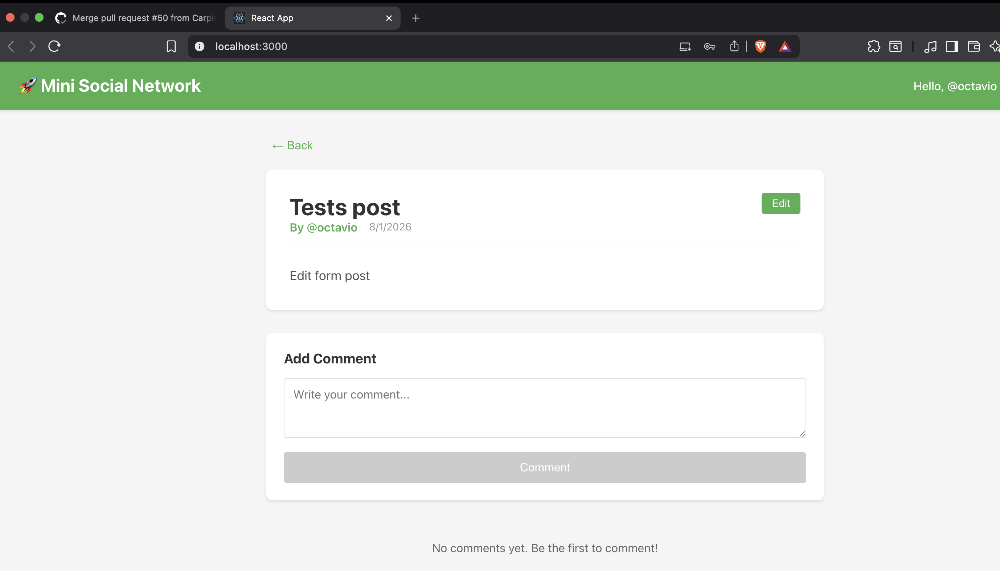

**06b — Edit form.** Title and content open in place, with Save and Cancel.

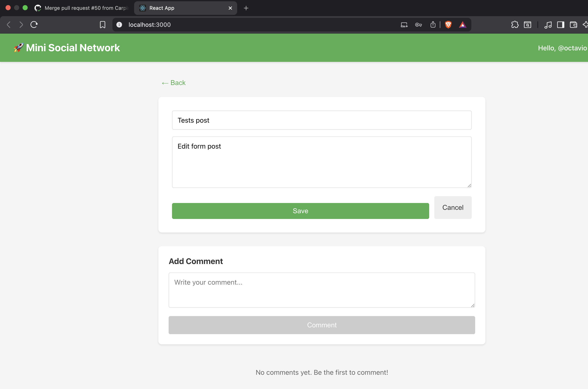

**07 — No Edit button for another user.** The same post, viewed by a different user. Hiding the button is presentation; the check that rejects an edit by a non-author is in the service layer ([ADR-005](../decisions/ADR-005-edit-functionality.md)).

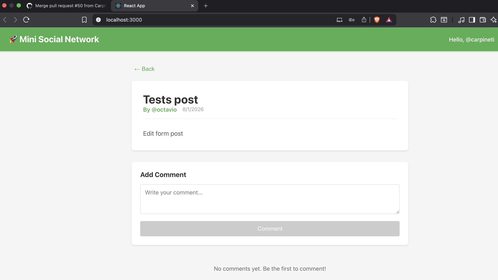
